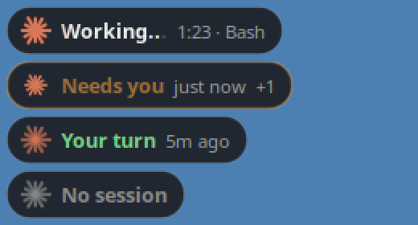

# Claude Code Overlay

A tiny always-on-top pill for Linux that shows what [Claude Code](https://claude.com/claude-code) is doing — so you can watch a video and still know the moment Claude needs you.



| State | Meaning |
|---|---|
| **Working...** | Claude is busy. The logo spins and the text shimmers; elapsed time and current tool are shown. |
| **Needs you** | Claude is waiting for a permission or a question answer. The border and text pulse amber. |
| **Your turn** | Claude finished its turn and waits for your next prompt. |
| **Ready / No session** | Session is idle, or no Claude Code session is running. The logo slowly "breathes" so you can see the overlay is alive. |

Works with every Claude Code session — terminal or the VS Code extension. With several sessions open it shows the most urgent one plus a `+N` counter; hover for the full list.

## Requirements

- Linux with X11, or GNOME/KDE on Wayland (the window runs through XWayland)
- Python 3 with GTK 3 bindings:

```bash
sudo apt install python3-gi python3-gi-cairo gir1.2-gtk-3.0   # Debian / Ubuntu
sudo dnf install python3-gobject gtk3                          # Fedora
```

## Install

```bash
git clone https://github.com/WhiteBeef/claude-code-overlay.git
cd claude-code-overlay
./install.sh                 # or ./install.sh --no-autostart
```

The installer:

1. copies `hook.py` and `overlay.py` to `~/.claude/overlay/`;
2. adds hooks to `~/.claude/settings.json` (a backup is saved as `settings.json.bak-overlay`);
3. adds `~/.config/autostart/claude-code-overlay.desktop` so the overlay starts on login;
4. starts the overlay.

Restart already open Claude Code sessions so they load the hooks.

## Usage

- **Drag** with the left mouse button. The position is remembered.
- **Right-click** for the menu: *Reset position*, *Quit*.
- Start manually: `python3 ~/.claude/overlay/overlay.py` (only one instance runs at a time).

## How it works

`hook.py` runs on Claude Code hook events (`UserPromptSubmit`, `PreToolUse`, `PermissionRequest`, `Notification`, `Stop`, …) and writes one small JSON file per session to `~/.claude/overlay/state/`. `overlay.py` polls these files twice a second and draws the pill with Cairo.

Some situations have no hook event, so the overlay fills the gaps itself:

- **Esc / rejected tool** — detected from the `[Request interrupted by user]` marker at the end of the session transcript.
- **Permission approved for a long command** — detected by a child process of Claude Code that has run for more than a second.
- **Closed or crashed session** — the state file is dropped once the Claude Code process is gone.

## Notes

- The window is an override-redirect X11 window, so it should stay above fullscreen video. Some Wayland compositors may still behave differently.
- Hook commands never print anything and always exit 0, so they can't block or change Claude Code's behavior.

## Uninstall

```bash
./uninstall.sh
```

## License

MIT. This is a community project and is not affiliated with or endorsed by Anthropic.
