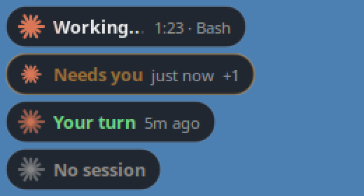

# AI Code Overlay

A tiny always-on-top pill that shows what your coding agent is doing — so you can watch a video and still know the moment it needs you. Supports [Claude Code](https://claude.com/claude-code), [Kimi Code](https://www.kimi.com/code) and [Codex](https://developers.openai.com/codex). Permission prompts and structured questions can be answered from the overlay.

Works on Linux, macOS and Windows.



| State | Meaning |
|---|---|
| **Working...** | The agent is busy. The logo spins and the text shimmers; elapsed time and current tool are shown. |
| **Needs you** | The agent is waiting for a permission or a question answer. The border and text pulse amber. |
| **Your turn** | The agent finished its turn and waits for your next prompt. |
| **Ready / No session** | Session is idle, or no coding agent session is running. The logo slowly "breathes" so you can see the overlay is alive. |

Works with every supported session — terminal or IDE extension. Show only the most urgent session (with a `+N` counter), or one pill per session. When several clients are active, the pill identifies Claude, Kimi or Codex.

| Client | Status display | Answer from overlay |
|---|---|---|
| Claude Code | Yes | Permissions and questions |
| Kimi Code | Yes | Approve, Reject, questions and per-session Auto mode |
| Codex | Yes | Allow and Deny |

## Requirements

- Python 3.9+. The installer creates its own virtualenv with [PySide6](https://pypi.org/project/PySide6-Essentials/) and [psutil](https://pypi.org/project/psutil/).
- Linux: X11, or GNOME/KDE on Wayland (the window runs through XWayland). Qt needs `libxcb-cursor0`, and Debian/Ubuntu need `python3-venv`:

```bash
sudo apt install python3-venv libxcb-cursor0
```

## Install

```bash
git clone https://github.com/WhiteBeef/claude-code-overlay.git
cd claude-code-overlay
./install.sh --clients all       # Windows: py install.py --clients all
```

Choose one client or a comma-separated list:

```bash
./install.sh --clients claude
./install.sh --clients kimi
./install.sh --clients codex
./install.sh --clients claude,kimi
./install.sh --clients all
```

The default is `claude`, preserving the original behavior. Other options: `--no-autostart`, `--no-statusline`.

The installer:

1. copies the shared scripts to `~/.claude/overlay/` and creates a virtualenv there;
2. adds hooks to `~/.claude/settings.json`, `~/.kimi-code/config.toml`, or `~/.codex/hooks.json` for each selected client;
3. backs up an existing client configuration as `<file>.bak-overlay` before changing it;
4. optionally points Claude Code's `statusLine` at the overlay's wrapper, which saves plan limits and then runs your previous status line command;
5. starts the overlay on login (`~/.config/autostart` on Linux, a LaunchAgent on macOS, the `Run` registry key on Windows) and right away.

`CLAUDE_CONFIG_DIR`, `KIMI_CODE_HOME` and `CODEX_HOME` are respected. Kimi hooks are kept inside a marked block. The installer enables `default_permission_mode = "auto"` for new Kimi sessions and restores the previous mode on uninstall. Run `/auto` in existing Kimi sessions.

Kimi's built-in Auto mode avoids structured questions and runs without approval when the overlay is closed. While the overlay is running, its `PreToolUse` bridge provides the approval buttons instead.

After installing for Codex, run `/hooks` in Codex and trust the overlay hooks. Codex skips untrusted hooks.

Restart already open sessions so they load the hooks.

## Usage

- **Drag** to move. The position is remembered.
- **Click** once to show the ⚙ settings and ✕ close buttons (or set `"controls": "hover"`). Click again to hide them. Tap-and-drag on a touchpad moves the overlay without toggling the buttons.
- **Right-click** for the menu: *Settings*, *Reset position*, *Quit*.
- **Answer prompts:** Claude Code shows *Allow*, *Always allow* (when it offers a rule) and *Deny*. Codex shows *Allow* and *Deny*. Questions show their options. The terminal prompt stays open at the same time, so answer wherever is closer: the first answer wins. *Hide* / *Answer in terminal* removes the buttons and leaves the prompt to the terminal.
- **Kimi Code prompts:** regular tools show *Approve*, *Reject* and *Auto mode*. Auto mode skips overlay approvals for the rest of that Kimi session. Structured questions show their options; if Kimi emits one while the overlay is unavailable, it stays in the terminal. Native Plan mode review remains in the terminal because Kimi always requires its own plan approval.
- Start manually: `~/.claude/overlay/venv/bin/python ~/.claude/overlay/overlay.py` (only one instance runs at a time).

## Configuration

The ⚙ panel covers the common options. Everything is in `~/.claude/overlay/config.json`, which the overlay rereads as soon as you save it. Missing keys fall back to the defaults, so you can keep only the ones you change.

```json
{
  "sessions": "top",
  "show": {
    "project": false,
    "elapsed": true,
    "tool": true,
    "five_hour": true,
    "seven_day": false,
    "reset_in": false
  },
  "interactive": { "enabled": true, "timeout": 600 },
  "controls": "click",
  "scale": 1.0,
  "opacity": 0.9,
  "font": "",
  "limit_warn": 70,
  "limit_alert": 90,
  "colors": {
    "accent": "#D97757", "background": "#1C1C1F", "text": "#EDEDED", "dim": "#9E9E9E",
    "waiting": "#FFA840", "done": "#73D985", "offline": "#8C8C8C", "alert": "#FF6B6B"
  },
  "labels": {
    "waiting": "Needs you", "working": "Working", "done": "Your turn",
    "idle": "Ready", "offline": "No session"
  }
}
```

| Key | Meaning |
|---|---|
| `sessions` | `"top"`: one pill for the most urgent session, `+N` for the rest. `"all"`: one pill per session, with its project name. |
| `show.project` | Project folder name in `"top"` mode. |
| `show.elapsed` | Turn duration while working, time since the agent stopped otherwise. |
| `show.tool` | The tool the agent is running. |
| `show.five_hour`, `show.seven_day` | Claude Code plan usage of the 5-hour and weekly windows, in percent. Amber from `limit_warn`, red from `limit_alert`. |
| `show.reset_in` | Time until the Claude Code 5-hour window resets. |
| `interactive.enabled` | Show answer buttons where supported, and pending-request cards for Kimi Code. |
| `interactive.timeout` | Seconds the overlay keeps the buttons for one prompt. Kimi allows at most 570 seconds. |
| `controls` | `"click"` or `"hover"`: what reveals the ⚙ and ✕ buttons. |
| `scale`, `opacity`, `font` | Size multiplier, background opacity (0–1), font family (empty = system font). |
| `colors`, `labels` | Any colour Qt understands (`#RRGGBB`, `#AARRGGBB`, `red`), and the status texts. |

Plan limits come from Claude Code's status line data, so they appear only for claude.ai Pro and Max subscriptions, after the first response in a session, and only from sessions that show a status line (the terminal).

## How it works

`hook.py --client <name>` runs on hook events and writes one small JSON file per client and session to `~/.claude/overlay/state/`. `overlay.py` polls these files twice a second and draws the pill with Qt.

For Claude Code and Codex, `PermissionRequest` publishes the request and waits. A click in the overlay writes the answer to `~/.claude/overlay/answers/`, and the hook returns the corresponding decision. If the overlay isn't running, you answer in the terminal, or `interactive.timeout` passes, the hook exits without a decision and nothing changes.

Kimi Code's `PermissionRequest` is observation-only, so interactive handling uses `PreToolUse` together with Kimi's Auto mode. Approve lets the tool continue; Reject returns a supported hook denial. Question answers are returned to the model in that denial result, with an instruction not to ask again. If the overlay is unavailable, the hook allows execution and Kimi's Auto mode continues without waiting. Native `PermissionRequest` events still provide terminal-only fallback cards for modes where Kimi asks directly.

Kimi Code 2.6.2 may not emit `Stop` after a completed TUI turn. The overlay also reads the latest `turn.ended` record in that session's `wire.jsonl`; newer prompt, model or tool records cancel the fallback, so an active turn stays `Working`.

`statusline.py` receives Claude Code status line JSON, saves `rate_limits` to `~/.claude/overlay/limits.json`, and passes the JSON to your original status line command (kept in `~/.claude/overlay/statusline.json`).

Some situations have no hook event, so the overlay fills the gaps itself:

- **Esc / rejected tool in Claude Code** — detected from the `[Request interrupted by user]` marker at the end of the session transcript. Kimi Code and Codex provide native `Interrupt` hooks.
- **Permission approved for a long command** — detected by a child process of the coding agent that has run for more than a second.
- **Closed or crashed session** — the state file is dropped once the coding agent process is gone.

## Notes

- Linux: the window bypasses the window manager (override-redirect), so it stays above fullscreen video. Some Wayland compositors may still behave differently.
- macOS: the overlay hides its Dock icon and asks to stay visible on all Spaces and above fullscreen apps.
- Windows: Claude Code hooks run through Git Bash, or PowerShell when Git Bash isn't installed. Codex uses its Windows command override when PowerShell is needed.
- Hook commands print nothing except a supported decision you clicked, and always exit 0. Reject deliberately blocks the requested tool; hook failures otherwise remain fail-open.

## Uninstall

Disconnect everything and remove the shared overlay:

```bash
./uninstall.sh                  # Windows: py uninstall.py
```

Disconnect only selected clients and keep the overlay for the others:

```bash
./uninstall.sh --clients kimi
./uninstall.sh --clients claude,codex
```

A full uninstall also puts your original Claude Code status line back. Removing only Claude Code hooks restores its status line without deleting the shared overlay.

## License

MIT. This is a community project and is not affiliated with or endorsed by Anthropic, Moonshot AI or OpenAI.
